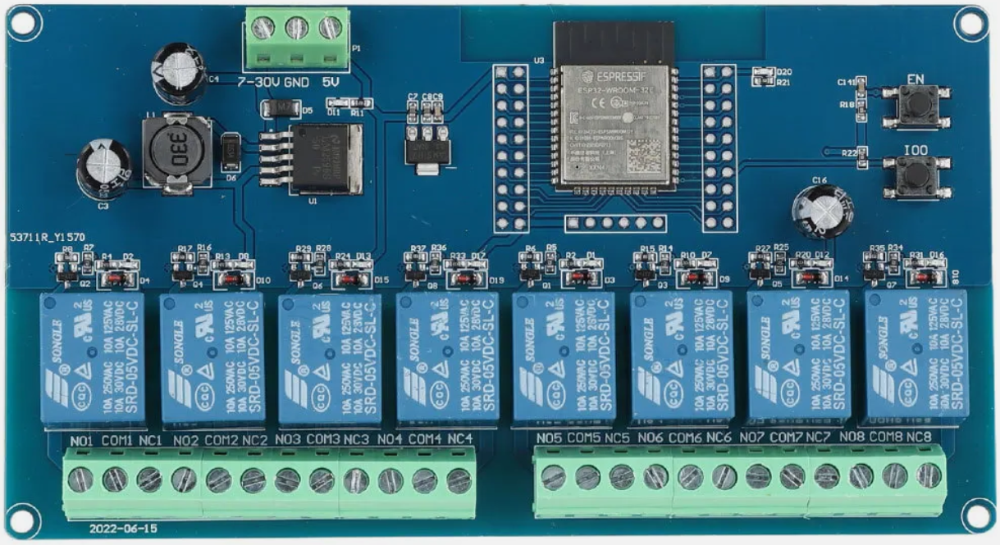
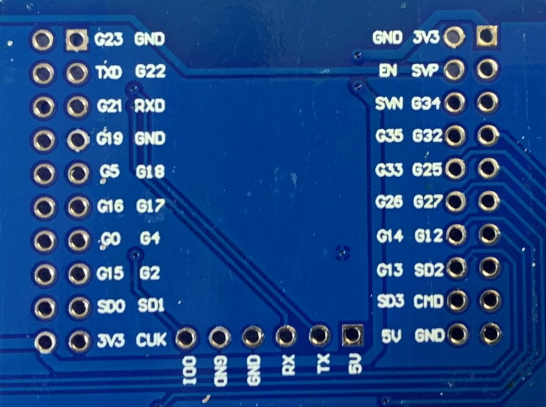
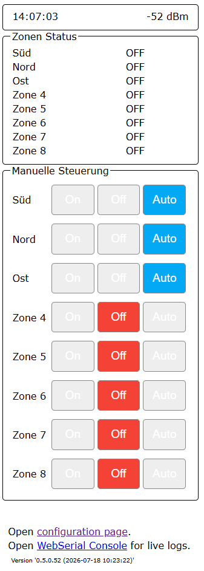
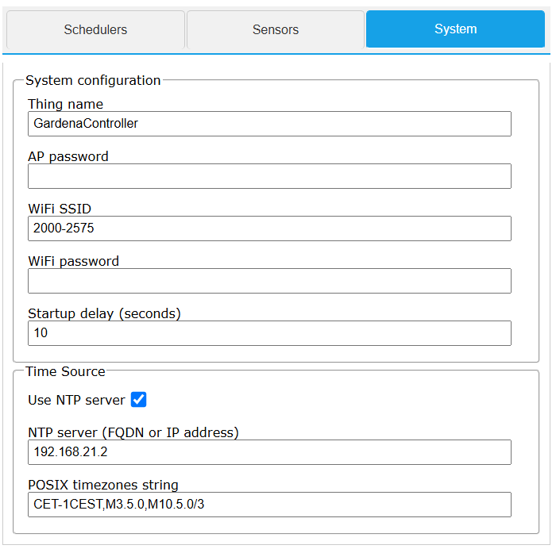
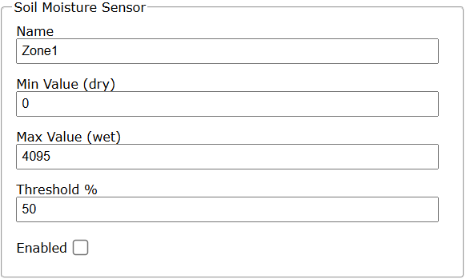
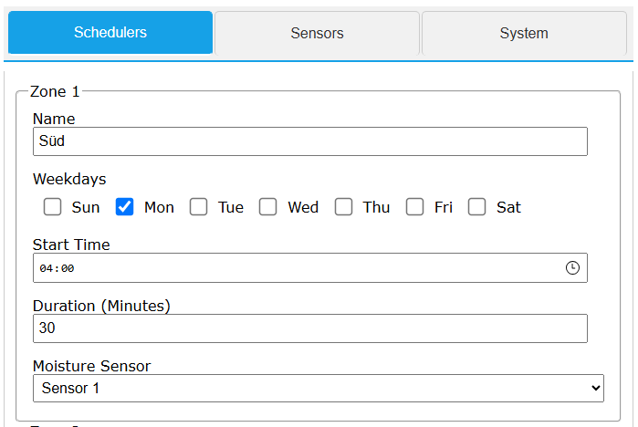

# Garden Computer

## Overview
The ESP32 Garden Computer is an intelligent irrigation controller for up to 6 valve zones. It is based on per-zone schedules, optional NTP time synchronization, and optional soil moisture gating with support for up to 2 soil moisture sensors.

## Features

### Zone Management
- Supports up to 6 irrigation zones (Relay 1-6)
- Each zone has its own schedule
- Each output can be manually set to ON/OFF or AUTO
- Manual ON mode includes automatic 30-minute timeout for safety
- Manual output state is stored persistently

### Soil Moisture Integration (Optional)
- Support for up to 2 soil moisture sensors
- Sensor 1: Analog input on GPIO36, power gating on GPIO13
- Sensor 2: Analog input on GPIO39, power gating on GPIO12
- **Measurement strategy**: 
  - Initial measurement is performed on startup if sensor is enabled
  - Subsequent measurements occur every 12 hours
  - Sensors are powered only during measurement, then powered off
  - This power-gating approach minimizes electrochemical corrosion and extends sensor lifespan
- Per-zone sensor assignment: each zone can use Sensor 1, Sensor 2, or None
- If soil moisture >= threshold: watering is blocked
- If soil moisture < threshold: schedules are allowed to water

### Outputs and Hardware
- 8 relay outputs (ESP32 8-Channel Relay Board)
- Relay pins:
  - Zone 1: GPIO32
  - Zone 2: GPIO33
  - Zone 3: GPIO25
  - Zone 4: GPIO26
  - Zone 5: GPIO27
  - Zone 6: GPIO14
  - Sensor 1 Power (Relay 7): GPIO13
  - Sensor 2 Power (Relay 8): GPIO12
- Internal LED: GPIO23
- Switching logic: HIGH = Relay ON, LOW = Relay OFF



## Technical Data
- Controller: ESP32
- Relays: 6 channels
- Soil Moisture Sensors: up to 2
- Time control: start time + duration + weekdays per zone
- Moisture sensor assignment: per-zone selection (None/Sensor 1/Sensor 2)
- Manual ON timeout: 30 minutes
- Time sync: optional NTP
- Web configuration: IotWebConfAsync

## Soil Moisture Sensors

### DFRobot Capacitive Soil Moisture Sensor

The system uses **DFRobot waterproof capacitive soil moisture sensors** for precise and long-lasting soil moisture measurement.

#### How It Works

The measurement probe is inserted directly into the soil and measures the capacitance of the soil, which changes based on moisture content. Unlike traditional resistive soil moisture sensors, capacitive sensors:
- Have **no moving parts or corrosion** - eliminating mechanical wear
- Provide superior **long-term reliability and lifespan**
- Are less affected by salt buildup and soil composition
- Deliver more accurate and stable readings

#### Sensor Specifications

- **Type**: Capacitive soil moisture sensor
- **Measurement Range**: 0-4095 (analog input, calibrated to 0-100%)
- **Operating Voltage**: 3.3V to 5V
- **Output**: Analog voltage (0-3.3V typical)
- **Sensitivity**: Adjustable via calibration (Min/Max values)
- **Detection Depth**: Approximately 5cm from probe tip

#### Longevity & Maintenance

To maximize sensor lifespan, **seal the cut edges of the sensor PCB** with clear lacquer or epoxy resin. Since the sensor's cut edges are not sealed at manufacturing, moisture can penetrate the board through these edges, potentially reducing lifespan. A protective coating prevents water ingress and significantly extends sensor durability.

**Recommended maintenance:**
1. After receiving the sensor, apply a thin coat of epoxy resin or clear lacquer to all cut edges
2. Allow to cure fully before use
3. Periodically inspect for damage or corrosion
4. Replace calibration values annually or if sensor readings become erratic

## Flashing the Relay Board (First Time)
To program the ESP32 relay board for the first time, use a hardware programmer such as ESP-Prog.



Firmware upload procedure:
1. Connect ESP-Prog (or a compatible programmer) to the expansion header as shown in the pinout image.
2. Enter programming mode:
  - Press and hold the IO0 (GPIO0) button.
  - While holding IO0, press the EN (Enable/Reset) button.
  - Release EN, then release IO0.
3. Confirm the serial output shows download mode:

```text
ets Jul 29 2019 12:21:46

rst:0x1 (POWERON_RESET),boot:0x3 (DOWNLOAD_BOOT(UART0/UART1/SDIO_REI_REO_V2))
waiting for download
```

4. Start firmware upload from your development environment (Arduino IDE, VisualMicro, or PlatformIO).
5. After upload completes, press EN once to reboot the board into normal run mode.

## Web Interface

The device is managed through a web interface accessible at the device's IP address. The interface includes a homepage for monitoring and manual control, and a configuration page for settings.

### Homepage (`/`)
The homepage shows real-time system status and manual zone control.

**Displayed information:**
- Current date and time (updated every second)
- Wi-Fi signal strength RSSI (updated every 5 seconds)
- Soil moisture levels (if sensors are enabled)
- Status of all 6 zones (ON/OFF)

**Manual zone control:**
- **On**: immediately activates the zone relay
  - Sets mode to `OUTPUT_ON`
  - Automatically switches back to `OUTPUT_AUTO` after 30 minutes for safety
  - Prevents accidental continuous watering
- **Off**: immediately deactivates the zone relay
  - Sets mode to `OUTPUT_OFF`
- **Auto**: returns zone to automatic scheduler control
  - Sets mode to `OUTPUT_AUTO`
  - Zone will follow its configured schedule

**Footer links:**
- Link to configuration page (`/config`)
- Link to WebSerial console (`/webserial`) for live logs and debugging
- Reboot button (`/reboot`)
- Home button (`/`)
- Reset to factory defaults button



### Configuration
The device is configured through the web interface at `/config`. The configuration page is rendered by IotWebConf and organized into the following sections.

#### System Configuration
Basic device connectivity and network settings.

**Configuration fields:**
- Thing Name: device name in the network (default: `GardenController`)
- AP Password: password for Access Point mode (initial default: `123456789`)
- WIFI SSID: Wi-Fi network name
- WIFI Password: Wi-Fi password
- AP Timeout: controls how long AP config mode stays active



#### Time Source (NTP)
Configure network time synchronization for accurate scheduling.

**Configuration fields:**
- Use NTP server (Checkbox)
  - Enables/disables NTP synchronization
  - If enabled: NTP client is started in `setup()` with the configured server and timezone
  - If disabled: no external time synchronization is used
- NTP server (FQDN or IP address)
  - Default: `pool.ntp.org`
- POSIX timezones string
  - Default: `CET-1CEST,M3.5.0,M10.5.0/3` (Central European Time)

#### Soil Moisture Sensors
Configure up to 2 independent soil moisture sensors for intelligent irrigation gating.

**Configuration fields per sensor (Sensor 1 and Sensor 2):**
- Name (Text)
  - Display name on the homepage and in logs
  - Default: `Soil Sensor`
- Min Value (dry) (Number 0..4095)
  - Calibration value for dry soil
  - Default: `0`
- Max Value (wet) (Number 0..4095)
  - Calibration value for wet soil
  - Default: `4095`
- Threshold % (Number 0..100)
  - Moisture percentage at which soil is considered sufficiently wet
  - Zones assigned to this sensor will not water when moisture >= threshold
  - Default: `50`
- Enabled (Checkbox)
  - Activates measurement and moisture gating logic for this sensor

**Measurement behavior:**
- Initial measurement on startup if sensor is enabled
- Subsequent measurements every 12 hours
- Sensor powered only during measurement, then powered off (reduces electrochemical corrosion)
- 10 samples averaged per measurement
- Raw value converted to 0..100%



#### Irrigation Zones (Schedulers)
Configure up to 6 irrigation zones with individual schedules and optional soil moisture gating.

**Configuration fields per zone (Zone 1 to Zone 6):**
- Name (Text)
  - Zone label/display name
- Weekdays (DayParameter)
  - Select which days this zone should water
  - Default: all days enabled
- Start Time (Time, HH:MM)
  - Time when watering starts
  - Default: `00:00`
- Duration (Minutes) (Number 0..240)
  - Runtime in minutes
  - `0` means zone is inactive
- Moisture Sensor (Dropdown)
  - Assigns a soil moisture sensor to this zone
  - Options: None, Sensor 1, Sensor 2
  - If set to None: zone is not gated by moisture (will water if time conditions are met)
  - If set to Sensor 1 or 2: zone will only water if moisture is below the sensor's threshold

**Scheduler logic:**
A zone will water only if ALL conditions are met:
- Duration > 0 (zone is active)
- Current day is selected in Weekdays
- Current time is between Start Time and Start Time + Duration
- (If configured) Assigned moisture sensor shows soil is dry enough
- Zone is in AUTO mode (not manually set to OFF)

Across-midnight schedules are supported (e.g., Start Time 23:00, Duration 90 minutes).

Manual ON/OFF modes override scheduler behavior completely.



After saving any configuration changes, the device will apply them and redirect back to the homepage.

## Getting Started & Troubleshooting

### Accessing the Web Interface

#### Default Credentials
- **Username**: `admin`
- **Password**: `123456789` (default, changeable via configuration page)

#### Network Connection

**Normal Mode (WiFi):**
- Connect your device to your local WiFi network via the configuration page
- Access the device at its assigned IP address (shown in your router)

**Access Point Mode (Initial Setup or WiFi Failure):**
- When not connected to WiFi or on first startup, the device creates its own WiFi network
- Default IP address: `192.168.4.1`
- Connect to the device's WiFi network with the default password: `123456789`
- Access the configuration page at `http://192.168.4.1/config`

### Firmware Update

To update the device firmware:
1. Navigate to the configuration page (`/config`)
2. Look for the "Firmware Update" link (usually at the bottom)
3. Select the new firmware file (`.bin` file)
4. Follow the on-screen instructions to complete the update
5. The device will reboot automatically after the update

**Important**: Do not disconnect power during the firmware update process.

### Factory Reset

If you need to reset the device to factory defaults:
1. On the homepage, scroll to the footer and click "Reset to factory defaults"
2. Confirm the action
3. The device will reset all settings and reboot

**Note**: The reset button on the web interface is currently enabled. The hardware CONFIG_PIN (GPIO 13) reset functionality is not yet implemented but can be enabled if needed.

### LED Indicator & Blinking Codes

The internal LED (GPIO 23) provides visual feedback about the device status through different blinking patterns. Understanding these codes helps with troubleshooting and monitoring device state without needing to access the web interface.

| Blinking Pattern | Meaning | Action |
|---|---|---|
| **Rapid blinking** (mostly on, interrupted by short off periods) | Entered Access Point (AP) mode. The device creates its own WiFi network. | Connect to the device's WiFi network with your smartphone or WiFi-capable computer using the default AP password (`123456789`). Access the configuration page at `192.168.4.1` to set up WiFi credentials. |
| **Alternating on/off blinking** | Device is attempting to connect to the configured WiFi network. | Wait for the connection to establish. Check WiFi credentials in the configuration if this persists. |
| **Mostly off with occasional short flash** | Device is online and connected to WiFi. Normal operation. | Everything is working correctly. The device is ready to receive commands and execute schedules. |
| **Mostly off with occasional long flash** | Device is in offline mode - no WiFi connection established. | Check WiFi network availability. Verify WiFi credentials in the configuration page. The device will continue running with last known schedule, but NTP time synchronization is unavailable. |

**Notes:**
- LED patterns are driven by the IotWebConf library's WiFi state management
- The LED can be used for quick status checks without accessing the web interface
- In offline mode, the device will still execute schedules based on its internal clock (not NTP synchronized)

### Troubleshooting

**Cannot access the web interface:**
1. Check if the device is powered and connected to your network
2. Try accessing the device by its IP address directly in your browser
3. If in doubt, the device enters AP mode automatically - connect to its WiFi network and use IP `192.168.4.1`

**Scheduler not working as expected:**
1. Verify NTP is enabled and the device has correct time synchronization
2. Check that the zone duration is set to a value > 0
3. Verify the weekdays are correctly selected
4. Check soil moisture sensor settings if a sensor is assigned to the zone

**Soil moisture sensor not responding:**
1. Ensure the sensor is enabled in the configuration
2. Check that the sensor is properly connected to the specified GPIO pins
3. Verify power supply to the sensor (via the relay/GPIO pins)
4. Calibrate the Min/Max values based on your specific sensor

## Runtime Behavior
- Scheduler evaluation cycle every 5 seconds
- NTP client processing while online
- Reboot handled via `ShouldReboot` flag
- Output modes are persisted in `Preferences` and restored on startup

## Missing Images
The project already contains image files in the `img` folder.

Available now:
1. `img/hardware-overview.png`
2. `img/homepage-manual-control.png`
3. `img/config-system.png`
4. `img/config-ntp.png`
5. `img/config-soil-sensor.png`
6. `img/config-zone-scheduler.png`
7. `img/esp32-pinout.jpg`

Still missing:
1. `img/wiring-diagram.png`
2. `img/apple-touch-icon.png`

Runtime note:
1. The homepage references `/apple-touch-icon.png`; this file should be added to match the HTML header links.
