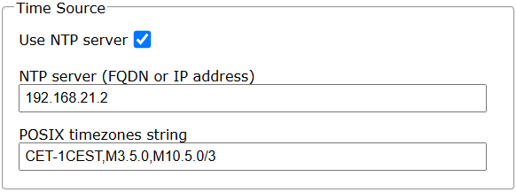

# Gardena Computer

## Overview
The ESP32 Gardena Computer is an intelligent irrigation controller for up to 8 valve zones. It is based on per-zone schedules, optional NTP time synchronization, and optional soil moisture gating.

## Features

### Zone Management
- Supports up to 8 irrigation zones (Relay 1-8)
- Each zone has its own schedule
- Each output can be manually set to ON/OFF or AUTO
- Manual output state is stored persistently

### Outputs and Hardware
- 8 relay outputs (ESP32 8-Channel Relay Board)
- Relay pins:
  - Zone 1: GPIO16
  - Zone 2: GPIO17
  - Zone 3: GPIO18
  - Zone 4: GPIO19
  - Zone 5: GPIO21
  - Zone 6: GPIO22
  - Zone 7: GPIO23
  - Zone 8: GPIO25
- Switching logic: LOW = Relay ON, HIGH = Relay OFF


### Soil Moisture Integration (Optional)
- Analog sensor input on GPIO36
- Sensor power switching on GPIO33 (power gating)
- Measurement interval: every 12 hours (default behavior)
- If soil moisture >= threshold: watering is blocked
- If soil moisture < threshold: schedules are allowed to water

## Technical Data
- Controller: ESP32
- Relays: 8 channels
- Time control: start time + duration + weekdays per zone
- Time sync: optional NTP
- Web configuration: IotWebConfAsync

## Flashing the Relay Board (First Time)
To program the ESP32 relay board for the first time, use a hardware programmer such as ESP-Prog.


Firmware upload procedure:
1. Connect ESP-Prog (or a compatible programmer) to the expansion header as shown in the pinout image.
2. Enter programming mode:
  - Press and hold the IO0 (GPIO0) button.
  - While holding IO0, press the EN (Enable/Reset) button.
  - Release EN, then release IO0.
3. Confirm the serial output shows download mode:

```text
ets Jul 29 2019 12:21:46

rst:0x1 (POWERON_RESET),boot:0x3 (DOWNLOAD_BOOT(UART0/UART1/SDIO_REI_REO_V2))
waiting for download
```

4. Start firmware upload from your development environment (Arduino IDE, VisualMicro, or PlatformIO).
5. After upload completes, press EN once to reboot the board into normal run mode.

## Configuration
The device is configured through the web interface at `/config`.

### System Settings
These fields come from the IotWebConf system section and define base connectivity.

- Thing Name: device name in the network (default: `GardenaController`)
- AP Password: password for Access Point mode (initial default: `123456789`)
- WIFI SSID: Wi-Fi network name
- WIFI Password: Wi-Fi password
- AP Timeout: visible/enabled, controls how long AP config mode stays active

### Time Source: NTPConfig.h (Form)
The `NtpConfig` class is a dedicated parameter group named "Time Source".

Form fields:
- Use NTP server (Checkbox)
  - Enables/disables NTP synchronization
  - Internally enabled when checkbox value is `selected`
- NTP server (FQDN or IP address) (Text)
  - Default: `pool.ntp.org`
- POSIX timezones string (Text)
  - Default: `CET-1CEST,M3.5.0,M10.5.0/3`

System behavior:
- If enabled, the NTP client is started in `setup()` using the configured server and POSIX timezone
- If disabled, no external time synchronization is used

### Soil Moisture: SoilMoistureSensor (Form)
The `SoilMoistureSensor` class is a parameter group named "Soil Moisture Sensor".

Form fields:
- Name (Text)
  - Display name on the homepage
  - Default: `Soil Sensor`
- Min Value (dry) (Number 0..4095)
  - Calibration value for dry soil
  - Default: `0`
- Max Value (wet) (Number 0..4095)
  - Calibration value for wet soil
  - Default: `4095`
- Threshold % (Number 0..100)
  - Soil is considered sufficiently wet at or above this value
  - Default: `50`
- Enabled (Checkbox)
  - Enables measurement and moisture gating logic

Measurement logic:
- Sensor is powered only for measurement (GPIO33 HIGH), then powered off again
- 10 samples are averaged per measurement
- Raw value is converted to 0..100% (map + constrain)
- Measurement interval: 12 hours

### Irrigation Zones: Scheduler.h (Form)
Each zone is represented by its own `Scheduler` parameter group (Zone 1 to Zone 8).

Form fields per zone:
- Name (Text)
  - Zone label
- Weekdays (DayParameter)
  - Select active weekdays
  - Default: all days
- Start Time (Time, HH:MM)
  - Zone start time
  - Default: `00:00`
- Duration (Minutes) (Number 0..240)
  - Runtime in minutes
  - `0` means inactive

Scheduler logic:
- A zone is active only if:
  - duration > 0
  - current day is selected
  - current time is between start and start + duration
- Across-midnight schedules are supported
- Manual ON/OFF output mode overrides scheduler behavior

## Web Interface

### Homepage (`/`)
The homepage shows runtime status and manual output control.

Displayed data:
- Time (`/DateTime`, updated every second)
- Wi-Fi signal strength RSSI (`/data`, 5-second cycle)
- Optional soil moisture percentage
- Status of all 8 zones (ON/OFF)

Manual control per zone:
- On: immediately sets relay ON, mode `OUTPUT_ON`
- Off: immediately sets relay OFF, mode `OUTPUT_OFF`
- Auto: returns control to scheduler logic, mode `OUTPUT_AUTO`


Footer links/functions:
- Link to configuration page (`/config`)
- Link to WebSerial console (`/webserial`)
- Reboot button (`/reboot`)
- Home button (`/`)
- Reset to factory defaults (POST to `/post` with `reset=true`)

### Config Page (`/config`)
The config page is rendered by IotWebConf and includes:
- System parameters (Thing Name, Wi-Fi, AP, etc.)
- Time Source Group (NTP)
- Soil Moisture Sensor Group
- 8x Scheduler Groups (Zone 1-8)

#### System configuration


#### NTP configuration


#### Soil moisture configuration


#### Zone scheduler configuration


After saving, the UI redirects back to the homepage.

## Runtime Behavior
- Scheduler evaluation cycle every 5 seconds
- NTP client processing while online
- Reboot handled via `ShouldReboot` flag
- Output modes are persisted in `Preferences` and restored on startup

## Missing Images
The project already contains image files in the `img` folder.

Available now:
1. `img/hardware-overview.png`
2. `img/homepage-manual-control.png`
3. `img/config-system.png`
4. `img/config-ntp.png`
5. `img/config-soil-sensor.png`
6. `img/config-zone-scheduler.png`
7. `img/esp32-pinout.jpg`

Still missing:
1. `img/wiring-diagram.png`
2. `img/apple-touch-icon.png`

Runtime note:
1. The homepage references `/apple-touch-icon.png`; this file should be added to match the HTML header links.
